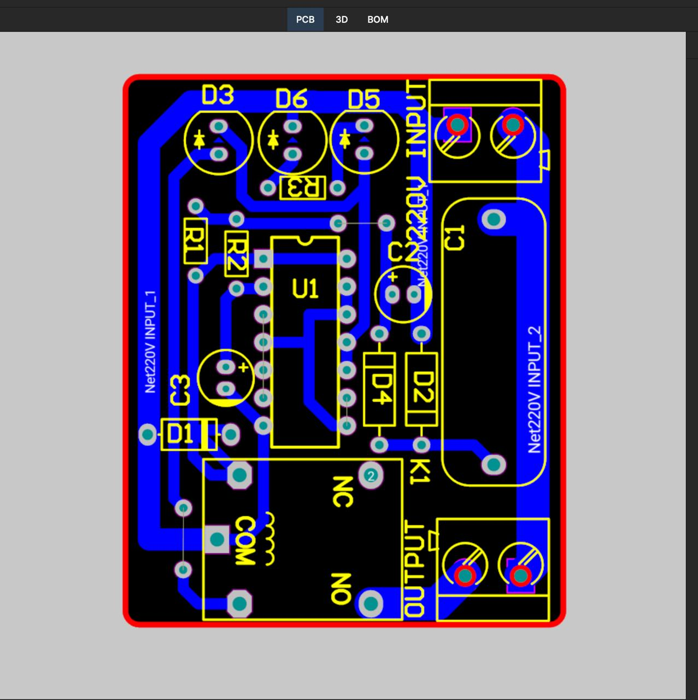

# electronic-circuit-pcb-design
Electronic circuit schematic and PCB design using Altium Designer
# Power-On Delay Relay – CMOS Circuit

## Project Overview
This project was developed during my Bachelor's studies in Electrical Engineering at Azad University of Shiraz.

The objective was to design an electronic circuit that activates a relay after a predefined delay using CMOS logic.

## Circuit Design
The design incorporates:
- CMOS logic IC
- RC timing network
- Relay output stage
- Capacitor-based power supply with Zener diode voltage regulation
## PCB Layout

## Schematic

[View Circuit Schematic (PDF)](Circuit_Schematic.pdf.pdf)
## Tools
- **Altium Designer:** Circuit schematic and single-layer PCB layout
- **Proteus:** Circuit simulation

## Project Work
- Designed a power-on delay relay circuit.
- Applied RC timing principles to control relay activation.
- Created the schematic and PCB layout using Altium Designer.
- Used Proteus for circuit simulation.

## Repository Files
- `Circuit_Schematic.SchDoc` – Altium circuit schematic
- `elc.pcb.PcbDoc` – Altium PCB layout

## Project Background
Bachelor's degree in Electrical Engineering, Azad University of Shiraz, Iran.

## Safety Note
The original design involves a mains-powered circuit. It is provided for educational documentation only and has not been independently verified against current electrical safety standards.
